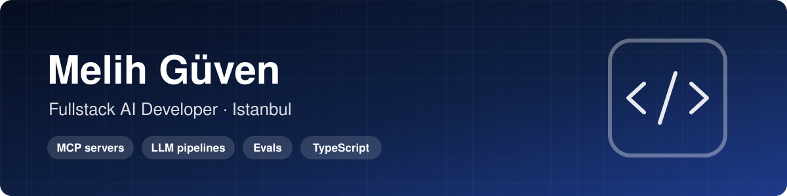

### 👋 Hi, I'm Melih

I take LLM features from a customer's problem to production: the pipeline, the integrations around it, and the evals that keep it honest.

### 🛠️ What I work on

- 🔌 **MCP servers in production:** OAuth 2.1, Streamable HTTP, multi-tenant isolation, and the stateless 2026-07-28 protocol revision
- 🧠 **LLM pipelines:** structured extraction, RAG, and eval suites that gate every prompt or model change
- 🔗 **Integrations:** messaging, email and calendar sources behind adapter-based architectures

### 🚧 Currently building

| Project | What it is |
| --- | --- |
| 📥 **briefcatch** | Catches customer requests in everyday conversations and turns them into a categorized to-do list, with human approval on every item. Multi-tenant, eval-driven, MCP 2.0 server. *Private for now.* |
| 🌦️ **Tulpar Go** | Hour-by-hour weather along your route, with risk thresholds per driver type. Expo + React Native, self-hosted Valhalla routing, MCP server. *Private for now.* |

### 🧰 Tech

### 📫 Elsewhere

🌐 [melihguven.dev](https://melihguven.dev)
